# Pixel Doll Studio tutorial

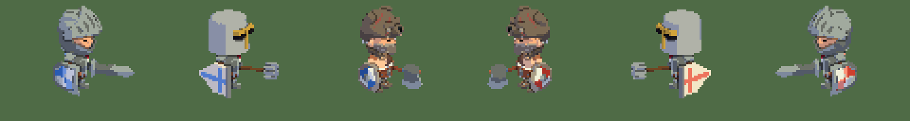

Pixel Doll Studio draws rigged 3D characters as live pixel art. A `PixelDoll` node (a `Sprite2D`) renders a skinned model in its own 96×64 viewport. The model is shaded in flat light bands, recolored with a palette, outlined at 1 px and given inner lines, and its clips play in steps like a hand-drawn sprite. The rig stays 3D, though: every clip, pose and piece of equipment of the 3D character keeps working.

This tutorial covers the whole workflow: building a skin, fitting pieces to bones, recoloring with palettes, tuning the style, making clips and using dolls in a game.

> The screenshots use the KayKit Adventurers characters and their medium rig's general animations, by Kay Lousberg ([www.kaylousberg.com](https://www.kaylousberg.com), CC0).

---

## 1. Concepts

| Resource | What it is | Example |
|---|---|---|
| `DollSkin` | How a doll looks: a 3D character, the pieces worn on its bones, hidden and recolored meshes | `skins/knight.tres` |
| `DollSlot` | One piece worn on one bone: bone + scene + offset | a sword on `handslot.r`, a shield on `handslot.l` |
| `DollRig` | A skeleton's animation libraries, shared by every skin built on it | `rig_medium.tres` |
| `DollPalette` | Three shades (light, mid, dark) that replace a skin's key color | `palettes/team_left.tres` |
| `DollStyle` | How every doll is drawn: camera, light, bands, lines, poses per second | `doll_style.tres` |
| `PixelDoll` | The node that puts it all on screen | a `Sprite` in a unit scene |

```
DollSkin ──► character (a .glb with a Skeleton3D)
   │   ├──► rig: DollRig ──► { "": rig_medium_general.glb, "doll": doll_clips.tres }
   │   └──► slots: [DollSlot(bone, piece, offset), …]
   │
PixelDoll ◄── skin + palette + style (+ flipped, direction)
```

---

## 2. Installing

1. Copy `addons/pixel_doll_studio/` into your project's `addons/` folder.
2. Enable **Pixel Doll Studio** in **Project › Project Settings › Plugins**.
3. A **Pixel Doll Studio** main screen appears next to 2D, 3D and Script.

Pixel Doll Studio needs Godot 4.7 or later.

### Language

The plugin's UI follows the editor's language (**Editor Settings › Interface › Editor › Localization › Editor Language**). It ships in English and Brazilian Portuguese. Resource, clip, bone and mesh names are never translated.

To add a language, copy `addons/pixel_doll_studio/translations/pixel_doll_studio.pot` to `<locale>.po` (e.g. `es.po`) in the same folder and fill in each `msgstr`. The plugin loads every `.po` there when it's enabled; disable and enable it again after editing one. Two messages carry a context (`msgctxt`) so the editor's own translation of the same words doesn't replace them.

---

## 3. The Pixel Doll Studio screen

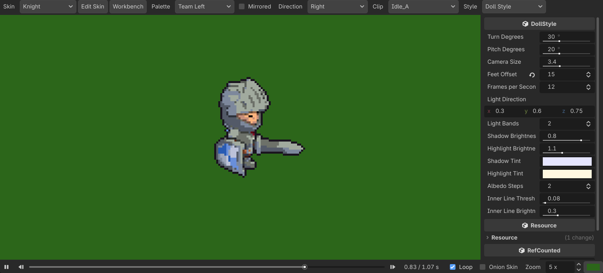

**Toolbar**

| Control | What it does |
|---|---|
| **Skin** | Every `DollSkin` `.tres` in the project; the list follows file changes |
| **Edit Skin** | Opens the skin in the Inspector |
| **Workbench** | Opens the skin on the 3D workbench (section 6) |
| **Palette** | The palette its recolored meshes take, or none |
| **Mirrored** | Mirrors the render (`flipped`) |
| **Direction** | One of 8 directions (the model turns), or **All** (section 8.4) |
| **Clip** | The clips of the skin's rig (`Idle_A`, `doll/defend`, …) |
| **Style** | The style the preview uses, edited in the side panel |

**Timeline** (bottom): play/pause, previous/next pose, scrubbing, **Loop**, **Onion Skin** (the previous pose, see-through, while paused), **Zoom** in whole pixels (1×–8×) and the background color.

**Shortcuts** (while the screen is visible and no text field has focus):

| Key | Action |
|---|---|
| Space | Play / pause |
| ← / → | Previous / next pose, at the style's `frames_per_second` |
| Home | Back to the start |

Everything picked here (skin, palette, mirroring, direction, clip, style, zoom, background, loop, onion skin) is remembered per project.

When there's nothing to show, the preview says what's missing: no skin in the project, a skin without a character, or a skin without clips.

---

## 4. Building a skin

### 4.1 The rig (once per skeleton)

1. In the FileSystem dock, right-click a folder › **Create New › Resource… › DollRig**.
2. Under **Animations**, add `library name → AnimationLibrary` entries:
   - `""` (the default library) → the animations imported with your rig (e.g. `rig_medium_general.glb`). Its clips show without a prefix: `Idle_A`, `Death_A`…
   - `"doll"` → an `AnimationLibrary` `.tres` of your own for hand-made clips. Its clips show as `doll/defend`.

> Libraries imported from a `.glb` are **read-only**. New clips can only go into `.tres` libraries.

### 4.2 The skin

1. **Create New › Resource… › DollSkin**, saved as e.g. `skins/knight.tres`.
2. In the Inspector, set:
   - **Display Name**: the name shown in game, in English (your game translates it where it's shown).
   - **Character**: a scene with a `Skeleton3D` inside, such as an imported `.glb`.
   - **Rig**: the `DollRig` from the previous step.
   - **Mirrored**: mirrors the model, e.g. so the shield arm faces the camera once the style turns the doll.
3. Once it has a character, the Inspector shows the doll **playing its idle clip** (the rig's first clip with "idle" in its name) and an **Open in Workbench** button.

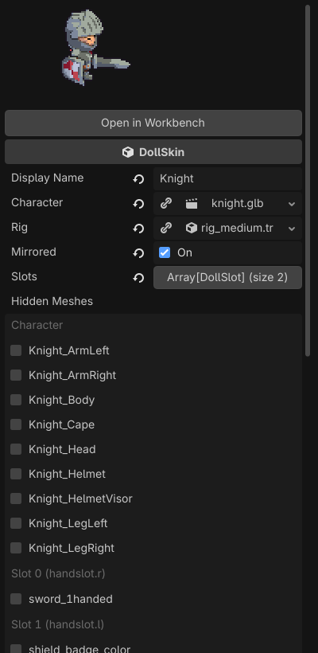

### 4.3 Pieces (slots)

1. Under **Slots**, add an element › **New DollSlot**.
2. **Bone**: picked from the character's skeleton. A bone the skeleton doesn't have stays listed, marked `(missing)`.
3. **Piece**: any 3D scene, an imported model (`sword_1handed.gltf`) or one built from primitives.
4. **Offset**: where the piece sits in the bone's space. No need to type it: fit it with the gizmos on the workbench (section 6).

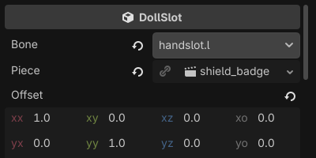

The offset lives in the bone's space, so it holds in every clip. For example, raising a shield along the bone's axis keeps the hand on its inner side in the T-pose and in every animation.

### 4.4 Hidden and recolored meshes

Both lists are **checklists**, grouped by where each mesh comes from (Character, Slot 0, Slot 1…):

- **Hidden Meshes**: character meshes that aren't drawn, e.g. the original helmet when a slot puts on another one.
- **Recolored Meshes**: meshes, in the character or in a piece, whose texels near the **Recolor Key** take the doll's palette.

The **Recolor Key** is the color the palette replaces. Each texel close to it takes the palette's light, mid or dark shade, picked by the texel's own brightness. Pick the model's accent color, e.g. the red of the knight's cape and shield.

Every change to a skin shows at once on the Pixel Doll Studio screen, in the thumbnail and on any `PixelDoll` open in the editor.

---

## 5. Palettes

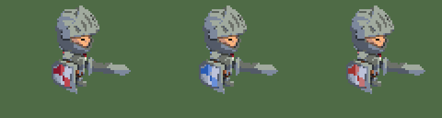

1. **Create New › Resource… › DollPalette**.
2. Set **Light**, **Mid** and **Dark**, lightest to darkest.
3. Pick it in the Pixel Doll Studio screen's **Palette** to check it.

Only palettes saved as `.tres` files show in the screen. Dolls sharing a palette share their materials.

---

## 6. The workbench

The workbench builds the skin in the **3D editor**, so you can use Godot's own tools on it: the move/rotate gizmos and the Animation panel.

**To open it:** click **Workbench** in the Pixel Doll Studio screen, or **Open in Workbench** in the skin's Inspector. The editor switches to 3D with `doll_workbench.tscn` open.

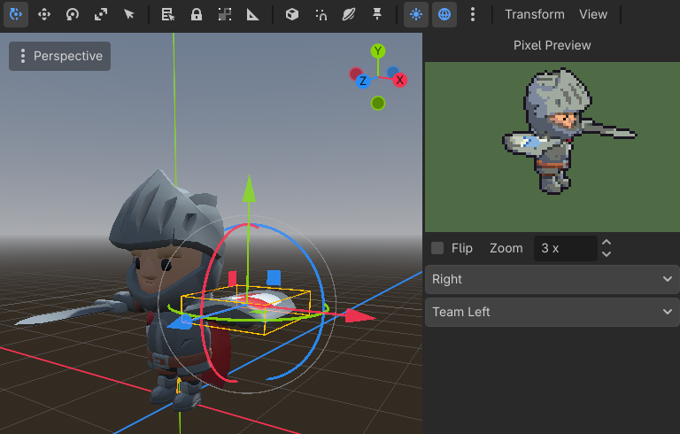

### 6.1 Fitting pieces

1. In the Scene dock, expand `Character › … › Skeleton3D › Slot1_handslot_l › Piece1`.
2. Move or rotate `PieceN` with the 3D gizmos.
3. Its `DollSlot.offset` follows.

> The workbench shows the character **unmirrored** (`mirrored` is ignored there), facing +Z.

### 6.2 Pixel Preview

While the workbench is open, a **Pixel Preview** panel sits at the 3D editor's right side. It draws the skin as a `PixelDoll` in the project's style and copies the workbench skeleton's pose at the style's pace. A pose made by hand, or a clip playing in the Animation panel, shows as pixel art at once, keyed or not.

Its options are **Flip** (mirror it), **Zoom** (1×–6×), the **direction** (to check a clip from all 8 sides) and the palette. They're remembered per project.

### 6.3 Making or editing clips

1. Select the workbench's `AnimationPlayer` node. It already holds the skin's rig.
2. In the **Animation** panel, pick a clip from a `.tres` library (e.g. `doll/defend`) or create one in it.
3. Select the `Skeleton3D`, pose its bones and insert keyframes as in any Godot animation.
4. Watch the Pixel Preview to see the result in pixels as you go.

### 6.4 Saving

**Ctrl+S** on the workbench (or **Save Skin and Clips** in the workbench root's Inspector) saves:

- the **skin**, when a piece moved;
- the rig's **`.tres` libraries**, where your keyframes live.

The character, the pieces and the skin picked **never** go into the scene file: `doll_workbench.tscn` stays empty and reusable.

When the skin changes elsewhere (e.g. in the Inspector), the workbench rebuilds itself.

---

## 7. Style

A `DollStyle` sets how **every** doll without a style of its own is drawn: tuning it restyles them all at once.

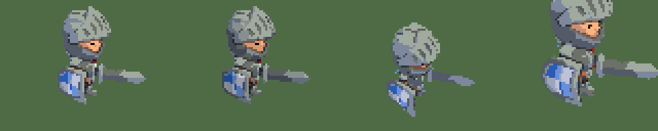

*Left to right: the default style; Light Bands 3 and Shadow Brightness 0.5; Pitch Degrees 45; Camera Size × 0.75.*

### 7.1 The project style

The addon's own style is **read-only**, so updating the addon can't undo your changes. To tune it:

1. In the Pixel Doll Studio screen, pick the addon's style under **Style**.
2. Click **Create Project Style…** and save the copy (e.g. `doll_style.tres`).
3. The copy becomes the project's style (**Project Settings › Pixel Doll Studio › Default Style**) and is picked right away.

The order a doll looks in: its own `PixelDoll.style`, then the project's style, then the addon's.

### 7.2 Settings

| Setting | Effect |
|---|---|
| **Turn Degrees** | How far the doll turns from its side profile towards the camera (0–90°); diagonals turn proportionally (section 8.4) |
| **Pitch Degrees** | How far the camera looks down (0–60°) |
| **Camera Size** | World units the render's 64 px of height span: bigger means a smaller doll |
| **Feet Offset** | Pixels from the render's center down to the feet |
| **Frames Per Second** | Poses per second: clips play in steps, like a sprite |
| **Light Direction** | The light's direction in view space |
| **Light Bands** | How many light bands (2–6) |
| **Shadow / Highlight Brightness** | How bright the darkest / brightest band is |
| **Shadow / Highlight Tint** | The shadows' / highlights' hue: pixel-art ramps shift hue, not just brightness |
| **Albedo Steps** | Flat tones kept from each of the texture's gradients (0 keeps the gradients) |
| **Inner Line Threshold** | How much closer (in world units) a neighbor must be to draw an inner line between parts |
| **Inner Line Brightness** | What a pixel on an inner line keeps of its color (1 hides the lines) |

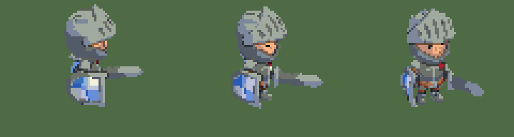

*Turn Degrees 0 (a flat profile), 30 (the default) and 60.*

Clips play in steps at **Frames Per Second**, re-rendering only on a new pose:

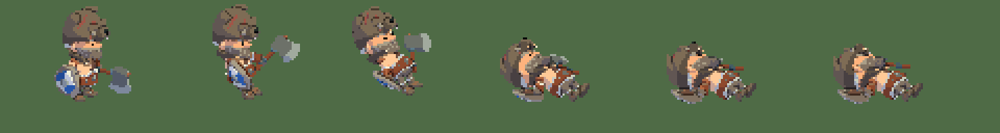

Edit the style in the Pixel Doll Studio screen's side panel with a clip playing to see each change at once.

---

## 8. Using dolls in a game

### 8.1 In a scene

Instance `res://addons/pixel_doll_studio/runtime/pixel_doll.tscn`. Don't use `PixelDoll.new()`: the node needs the scene's `Viewport`, camera and `AnimationPlayer`. In the Inspector, set **Skin**, **Palette**, **Flipped**, **Direction** and, optionally, **Style**.

### 8.2 From code

```gdscript
const TEAM_PALETTE := preload("res://palettes/team_left.tres")

@onready var doll: PixelDoll = $Doll


func _ready() -> void:
	doll.skin = preload("res://skins/knight.tres")
	doll.palette = TEAM_PALETTE
	doll.flipped = true  # faces left: the render and its light are mirrored
	doll.animation_player.play(&"doll/defend")
```

Other useful calls:

- `doll.pose(&"Death_A", 0.4)` freezes a clip at a time, e.g. to scrub through it.
- `doll.match_pose(skeleton)` copies the pose of another `Skeleton3D` on the same rig.

### 8.3 From another animation

An `AnimationPlayer` in the doll's owner can start its clips with an **Animation Playback Track** on `<Doll>/Viewport/AnimationPlayer`, the clip's name as the key (e.g. `doll/defend`).

Being a `Sprite2D`, a doll shakes, flips, `modulate`s and `self_modulate`s like any sprite.

### 8.4 Eight directions

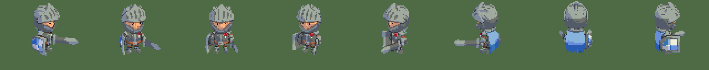

`direction` turns the **model** to look one of 8 ways on screen: `RIGHT`, `DOWN_RIGHT`, `DOWN`, `DOWN_LEFT`, `LEFT`, `UP_LEFT`, `UP`, `UP_RIGHT`. Down is towards the camera and up shows the doll's back.

```gdscript
func _physics_process(_delta: float) -> void:
	if velocity.length() > 0.1:
		doll.direction = PixelDoll.direction_of(velocity)  # the closest direction (+y is down)
```

In the Pixel Doll Studio screen, **Direction › All** shows all 8 around the center, each doll placed where it looks:

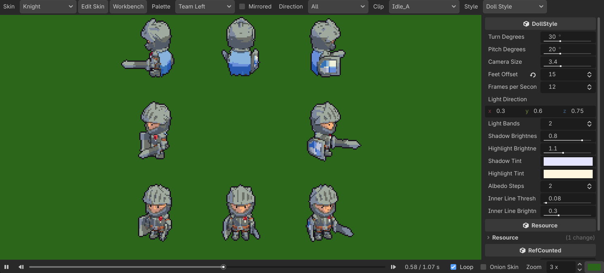

**`flipped` or `direction = LEFT`?**

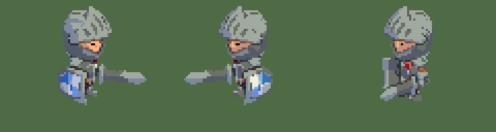

*Left to right: looking right; `flipped`; `direction = LEFT`.*

| | `flipped` | `direction = LEFT` |
|---|---|---|
| How it turns | Mirrors the render | Turns the 3D model |
| Weapon hand | Swaps sides (which is why skins have `mirrored`) | Stays; you see the character's other side |
| Cost | The same | The same |

They combine: `flipped` mirrors whatever `direction` shows. For a game with two mirrored sides, `flipped` is enough. For characters moving freely around a field, use `direction`.

**How Turn Degrees applies:** the style turns the view towards the camera as much as the direction looks sideways (`turn × cos(angle)`). `RIGHT` therefore matches the default, `LEFT` is its true mirror image, `DOWN` faces the camera and `UP` shows the back. With a high turn, the front views look closer to each other and the back views further apart; at 0 the 8 views sit exactly 45° apart.

The light stays fixed on screen for every direction: the same side lights every doll.

---

## 9. Troubleshooting

| Symptom | Likely cause |
|---|---|
| The preview says "No DollSkin in the project yet" | No `.tres` with the `DollSkin` script saved yet |
| "This skin has no character" | The skin's **Character** is empty |
| "This skin has no clips to play" | The skin has no **Rig**, or its rig has no libraries |
| Error `has no mesh named … to hide` | A name in **Hidden Meshes** the character no longer has |
| A bone shows as `(missing)` | The slot's bone isn't in the character's skeleton |
| The palette doesn't apply | The mesh isn't in **Recolored Meshes**, or the **Recolor Key** is far from the texture's actual color |
| Keyframes aren't saved | The clip is in an imported library (`.glb`): move it into a `.tres` one |
| A piece is on the wrong side in game | The workbench doesn't mirror: check **Mirrored** in the Pixel Doll Studio screen |
| A weapon's blade or a shield faces the wrong way in clips | Rotate the piece 180° around its handle on the workbench (its offset is in the bone's space, so the fix holds in every clip) |
